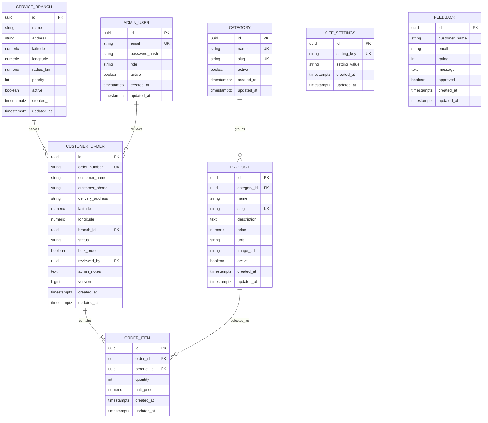

# Initial ERD

The initial catalog and a sample service branch are inserted by Flyway. The first admin account is bootstrapped from environment variables and its password is BCrypt-hashed at startup.
